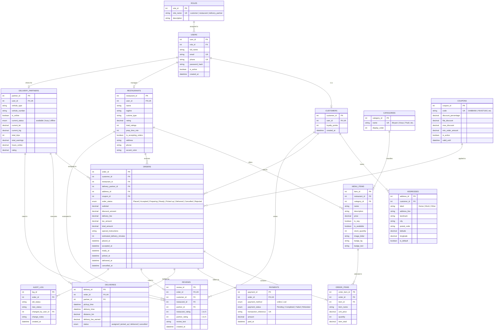

# Dabba: Online Food Ordering System - Entity Relationship (ER) Diagram

This document contains the complete Entity-Relationship model for the **Dabba** Online Food Ordering System. The schema is designed in Third Normal Form (3NF) to support a unified multi-role workflow (Customer, Restaurant, Delivery Partner) over a single MySQL 8 database.

---

## Mermaid ER Diagram

---

## Relationship Cardinalities Summary

| Parent Entity | Child Entity | Cardinality | Business Meaning / Integrity Rule |
|---|---|---|---|
| `roles` | `users` | 1 : N | Each role classifies multiple system users; users have exactly one role. |
| `users` | `customers` | 1 : 1 | Customer profiles are subtypes of users (ON DELETE CASCADE). |
| `users` | `restaurants` | 1 : 1 | Restaurant owner profiles are subtypes of users (ON DELETE CASCADE). |
| `users` | `delivery_partners` | 1 : 1 | Delivery rider profiles are subtypes of users (ON DELETE CASCADE). |
| `customers` | `addresses` | 1 : N | Customers can save multiple delivery addresses (Home, Work, etc.). |
| `customers` | `orders` | 1 : N | Customers place zero or more food orders. |
| `restaurants` | `menu_items` | 1 : N | Each restaurant manages their own dishes and live stock levels. |
| `categories` | `menu_items` | 1 : N | Generic categories group dishes across restaurants. |
| `orders` | `order_items` | 1 : N | Each order contains one or more line items (composite details). |
| `orders` | `payments` | 1 : 1 | Exactly one payment record exists per order. |
| `orders` | `deliveries` | 1 : 1 | Exactly one delivery assignment record per order. |
| `orders` | `reviews` | 1 : 1 | At most one verified review can be submitted per order. |
| `orders` | `audit_log` | 1 : N | Every status transition is automatically tracked by MySQL triggers. |

